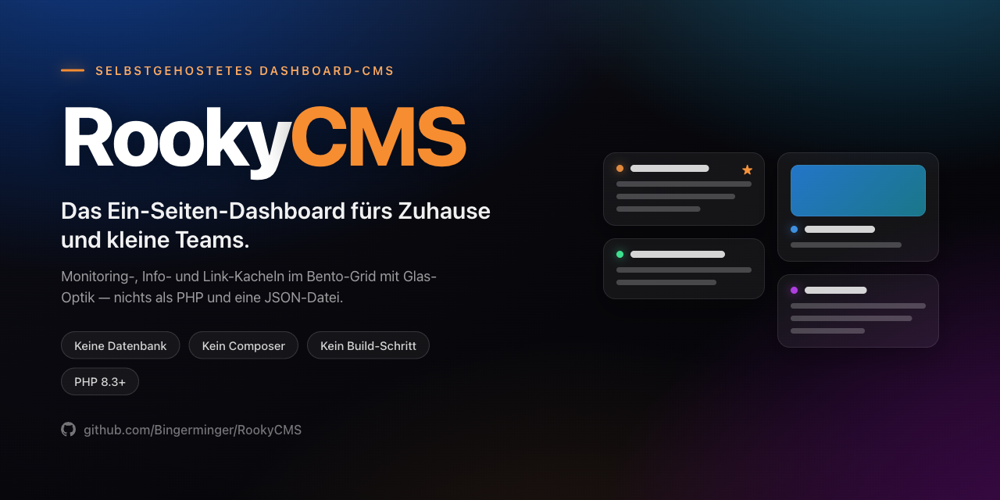
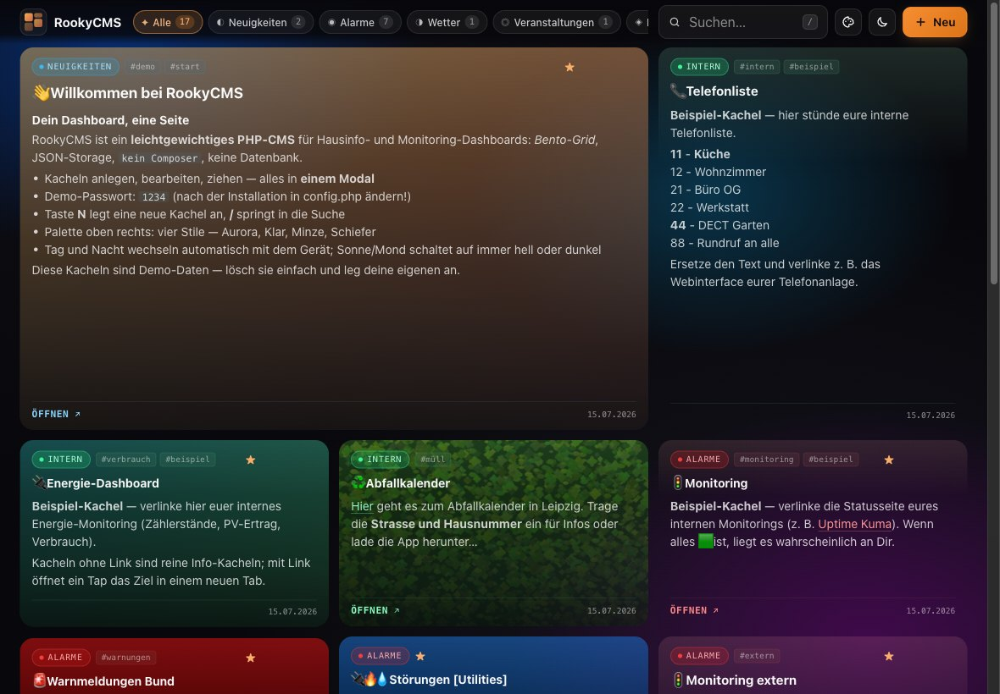
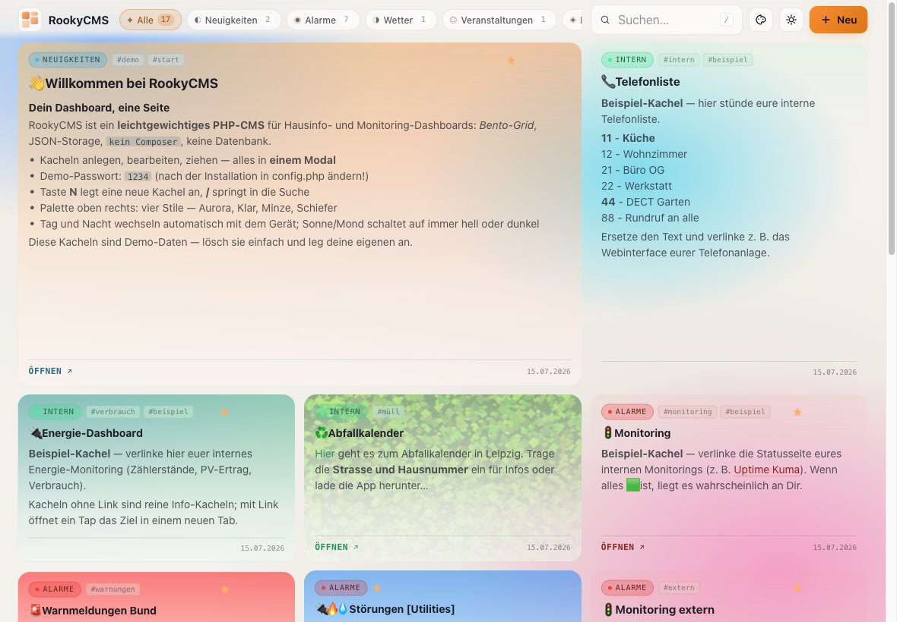
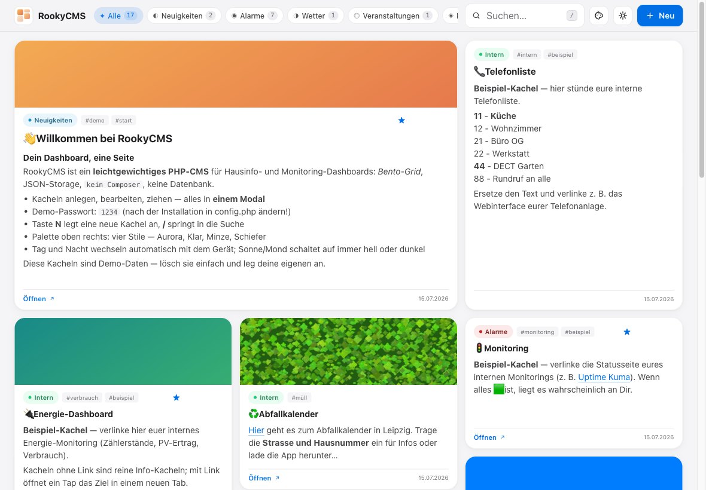
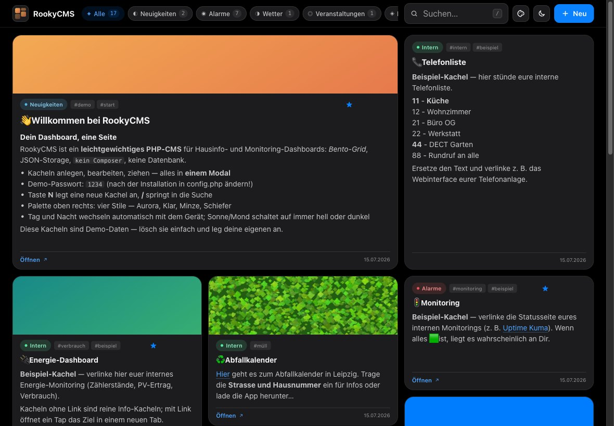
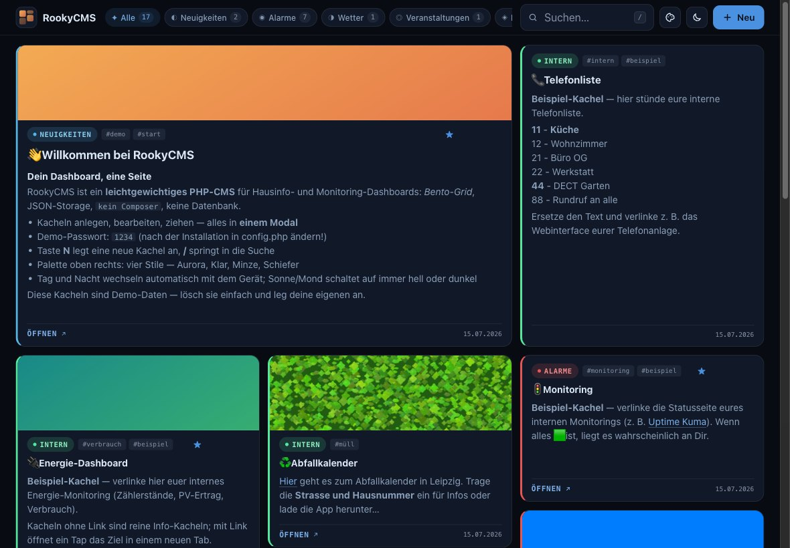
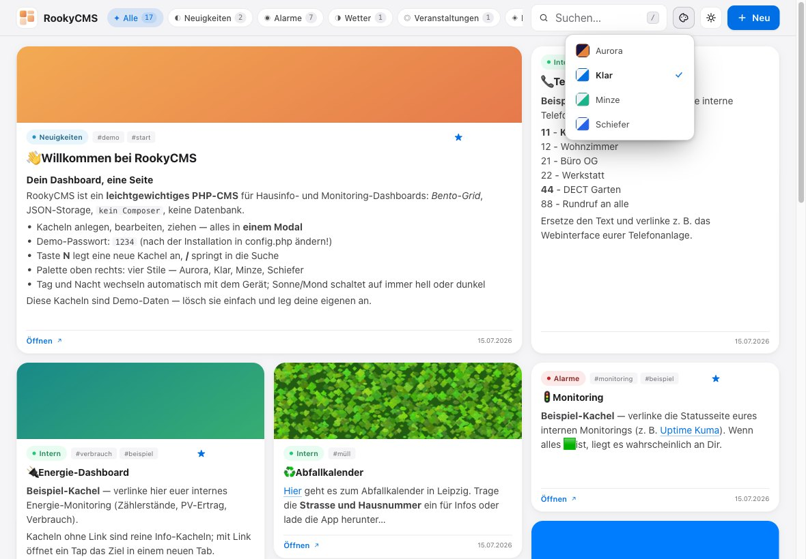
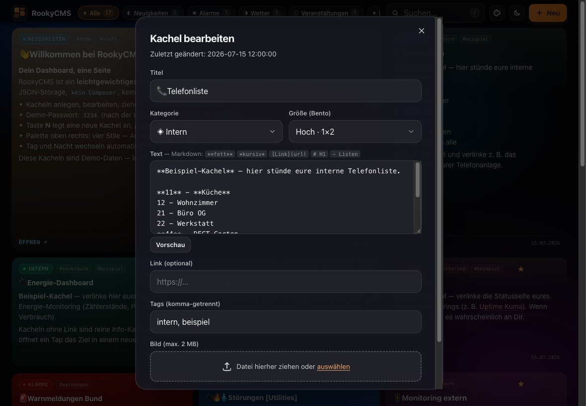
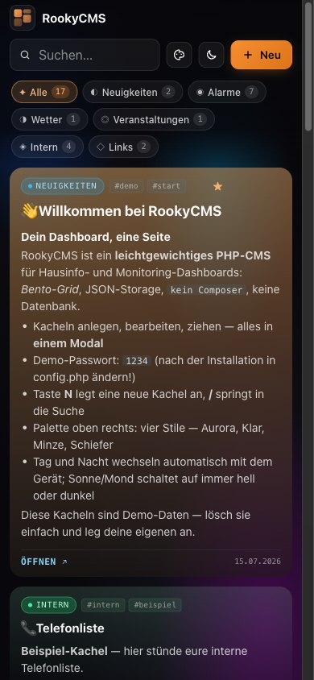
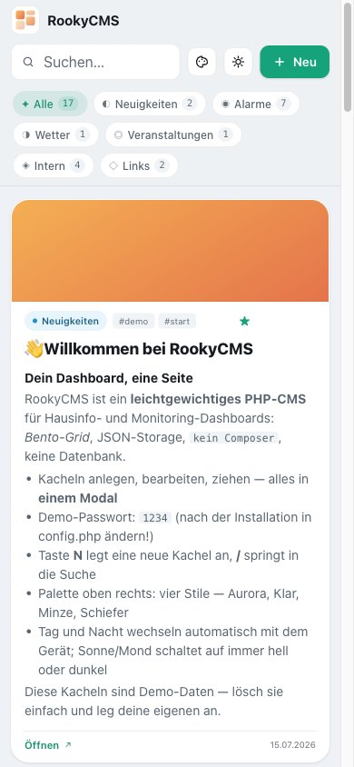

<p align="center">
  
</p>

# RookyCMS

**Das Ein-Seiten-Dashboard fürs Zuhause und kleine Teams.**
Monitoring-, Info- und Link-Kacheln in einem Bento-Grid mit Glas-Optik — betrieben mit nichts als PHP und einer JSON-Datei. Keine Datenbank, kein Composer, kein Build-Schritt, keine externen Requests.

**▶ [Live-Demo ausprobieren](https://bingerminger.github.io/RookyCMS/)** — mit den 17 Beispiel-Kacheln, allen vier Stilen und dem Bearbeiten-Modal (Passwort `1234`), ganz ohne Installation. Gespeichert wird in der Demo nichts.

[](https://buymeacoffee.com/bingerminger)



## Warum RookyCMS?

Gebaut für den Dauerbetrieb auf einem **Wand- oder Küchen-Tablet im Intranet** (z. B. auf einem NAS): Eine Übersichtsseite zeigt alles, was der Haushalt oder das Team braucht — Monitoring-Status, Warnmeldungen, Wetter, interne Tools, Links. Bearbeitet wird direkt auf der Seite über ein einziges Modal.

- **Eine Seite, ein Modal.** Anlegen, Bearbeiten, Löschen, Umsortieren — ohne Seiten-Reload, ohne Adminbereich.
- **JSON statt Datenbank.** Der komplette Bestand lebt in `data/entries.json` — mit exklusivem Lock, atomarem Schreiben und automatischer Backup-Rotation trotzdem robust.
- **Ruhig im Betrieb.** Statischer Aurora-Hintergrund, kein `backdrop-filter`, keine Endlos-Animationen — keine GPU-Dauerlast auf Tablets. Leises Polling aktualisiert nur bei echten Änderungen und ruht, solange der Bildschirm aus ist.
- **Tablet-taugliche Sicherheit.** Kein dauerhaftes Eingeloggt-Sein: Jede Schreibaktion fragt das Passwort frisch ab, es wird nie gespeichert. Wer es durchprobieren will, wird nach fünf Fehlversuchen ausgebremst. Das Wand-Tablet darf öffentlich hängen.
- **Vier Stile, Tag und Nacht von selbst.** Aurora (bunt, mit Glas-Optik) und drei leichte, flache Stile — Klar, Minze, Schiefer —, jeder mit Tag- und Nachtansicht. Tag und Nacht wechseln automatisch mit dem Gerät: Schaltet das Tablet abends auf dunkel, zieht das Dashboard mit.
- **Läuft überall, wo PHP läuft.** PHP 8.3+, Systemschriften, keine CDNs — auch im Intranet ohne Internetzugang.

## Screenshots

| Nacht (Aurora) | Tag (Aurora) |
|---|---|
|  |  |

| Klar (Tag) | Klar (Nacht) |
|---|---|
|  |  |

| Minze (Tag) | Minze (Nacht) |
|---|---|
|  |  |

| Schiefer (Tag) | Schiefer (Nacht) |
|---|---|
|  |  |

| Stil-Auswahl | Bearbeiten-Modal |
|---|---|
|  |  |

<p align="center">
  
  
</p>

### Die Stile

| Stil | Anmutung | Vorbild |
|---|---|---|
| **Aurora** | bunt, Glas-Optik über weichem Farbverlauf — der Standard | — |
| **Klar** | ruhiges Grau, weiße Karten, Blau als Akzent | Apple (macOS/iOS) |
| **Minze** | frisch und rund, randlose Karten, Minzgrün | cat-o-fit |
| **Schiefer** | sachlich, Kategorie als Randstreifen, Beschriftung in Mono | Energietracker |

Die drei leichten Stile zeigen Kachelbilder als Kopfband in voller Farbe; die Kategoriefarbe steckt im Badge statt in der ganzen Kachel.

## Schnellstart

```bash
git clone https://github.com/Bingerminger/RookyCMS.git
cd RookyCMS/public
php -S localhost:8000
```

Browser: `http://localhost:8000` — fertig.

Beim ersten Aufruf passiert automatisch:

1. `config.php` wird aus `config.example.php` erzeugt (**Demo-Passwort: `1234`**).
2. Der **Demo-Datenbestand** aus `demo-data/` wird als Startinhalt übernommen (17 Beispiel-Kacheln inkl. Bildern).

Danach: **Passwort in `public/config.php` ändern**, Demo-Kacheln nach Belieben löschen und eigene anlegen. Wer leer starten will, löscht einfach alle Demo-Kacheln — der Seed läuft nur, wenn noch gar keine Datendatei existiert.

## Bedienung

| Aktion | So geht's |
|--------|-----------|
| Neue Kachel | Button **„Neu"** oder Taste `N` |
| Bearbeiten / Löschen | Icons auf der Kachel (bei Hover, auf Touch immer sichtbar) |
| Verschieben | Kachel per Drag & Drop ziehen; Drop im Freiraum hängt ans Ende |
| Suchen | `/` fokussiert die Suche (matcht Titel, Text, Tags) |
| Filtern | Kategorie-Chips in der Topbar, Zähler laufen live mit |
| Stil | Palette-Button: Aurora, Klar, Minze oder Schiefer — mit Farbvorschau |
| Tag / Nacht | Sonne/Mond-Button: **automatisch** (Standard, kleines „A" am Knopf) → immer hell → immer dunkel |
| Modal schließen | `ESC` |

Jede Schreibaktion fragt das Passwort ab; nach dem Speichern (oder Abbrechen) ist man automatisch wieder abgemeldet. Stil und Tag/Nacht merkt sich jedes Gerät selbst. Im Automatikmodus folgt das Dashboard dem Hell/Dunkel-Modus des Geräts — auch, während es offen ist; das Symbol zeigt, was gerade gilt.

### Kachelgrößen (Bento)

| Größe | Belegung |
|-------|----------|
| Standard | 1×1 |
| Breit | 2×1 |
| Hoch | 1×2 |
| Groß | 2×2 |

Das Grid ist ein **Masonry-Layout**: Jede Kachel zeigt immer ihren kompletten Inhalt (nichts wird abgeschnitten, auch lange Adressen brechen um), die Spaltenzahl wächst mit dem Viewport (1/2/3/4/5/6 Spalten ab 0/640/960/1280/1600/2000 px). Auf dem Smartphone werden alle Kacheln einspaltig.

### Markdown

Im Kacheltext unterstützt (Vorschau im Editor eingebaut):

| Syntax | Ergebnis |
|--------|----------|
| `# H1` … `###### H6` | Überschriften |
| `**fett**` / `*kursiv*` | **fett** / *kursiv* |
| `` `code` `` / `~~strike~~` | `code` / ~~strike~~ |
| `[Text](URL)` | Link (öffnet in neuem Tab) |
| `- Item` | Listen |
| Zeilenumbruch / Leerzeile | Umbruch / Absatz |

Das HTML wird ausschließlich **serverseitig** und XSS-sicher erzeugt — der Client parst kein Markdown. Links (im Text wie im Feld „Link") gehen nur mit `http(s)`, `mailto`, `tel`, `ftp`, `smb`, `ssh`, `vnc`, `rdp` oder als relativer Pfad durch; `javascript:` & Co. bleiben reiner Text.

## Konfiguration

`public/config.php` (entsteht aus `config.example.php`):

| Konstante | Bedeutung |
|-----------|-----------|
| `ADMIN_PASSWORD` | Passwort für alle Schreibaktionen — **unbedingt ändern!** |
| `AUTO_REFRESH_SECONDS` | Polling-Intervall in Sekunden (`0` = aus) |
| `SITE_TITLE` | Titel in Topbar und Browser-Tab |

Akzentfarbe und Raster-Dichte: `public/css/styles.css` (`--accent-h/-s/-l` bzw. Media Queries unter „Bento Grid").

## Installation & Betrieb

Kurzfassung: Webroot auf `public/` zeigen lassen (oder das Projekt in einen Webserver-Ordner legen und `…/public` aufrufen), PHP 8.3+ mit Schreibrecht auf `public/data/` und `public/uploads/` — mehr braucht es nicht. GD ist optional (verkleinert große Upload-Bilder automatisch). Unter Apache sperrt die mitgelieferte `public/.htaccess` den Datenordner; für nginx steht die passende Regel in der Installationsanleitung.

Details für NAS (Synology Web Station), Apache, nginx und Updates: **[docs/INSTALL.md](docs/INSTALL.md)**

## Technik

- **[docs/ARCHITECTURE.md](docs/ARCHITECTURE.md)** — Rendering-Modell, Persistenz-Robustheit (Lock + atomares Schreiben + Backups), Polling, Masonry-Layout, Demo-Modus, Performance-Prinzipien
- **[docs/API.md](docs/API.md)** — die sechs AJAX-Endpoints mit Beispielen
- **[docs/SECURITY.md](docs/SECURITY.md)** — Auth-Modell, Drosselung, Bedrohungsannahmen, Upload-Härtung
- **[CHANGELOG.md](CHANGELOG.md)** — Versionshistorie

Stack: PHP 8.3+ (Enums, Readonly Properties, typed class constants), Vanilla JS (eine ES6-Klasse), CSS3 mit Custom Properties. Keine Abhängigkeiten.

```
public/                     Webroot: index.php, api.php, CmsManager.php, css/, js/, .htaccess
demo-data/                  Demo-Kacheln + -Bilder (Startbestand beim Erststart)
tools/selftest.php          Selbsttest ohne Abhängigkeiten: php tools/selftest.php
tools/build-demo.sh         Öffentliche Demo als statische Seite (GitHub Pages)
.github/workflows/ci.yml    Syntax + Selbsttest + Demo-Probebau bei jedem Push
.github/workflows/pages.yml Baut + veröffentlicht die Demo (bei Releases, von Hand)
VERSION                     Release-Version (steht auch im <head> und in der Fußzeile)
```

## Herkunft

RookyCMS ist aus einem privaten Hausinfo-Dashboard („SimpleCMS") hervorgegangen, das seit Jahren auf einem Küchen-iPad im Dauereinsatz ist. Die Demo-Daten zeigen genau diesen Anwendungsfall — ein Haushalt in Leipzig. 😉

## Unterstützen

RookyCMS ist unabhängig: keine Firma dahinter, keine Werbung, kein Cloud-Konto, keine Datensammlung — es läuft bei dir im Heimnetz und fragt niemanden. Wenn es dir den Alltag am Küchen-Tablet leichter macht und du etwas zurückgeben möchtest, kannst du mir [einen Kaffee spendieren](https://buymeacoffee.com/bingerminger) — ganz freiwillig. Sterne, Fehlermeldungen und Weitersagen helfen genauso.

## Lizenz

Seit Version 1.2.0 steht RookyCMS unter der [GNU AGPL v3.0 oder neuer](LICENSE). In einfachen Worten:

- **Zu Hause gehört es dir:** kostenlos nutzen, verändern, weitergeben — ohne Bedingungen, ohne Konto, ohne Gebühr.
- **Nur eine Regel:** Wer eine *veränderte* Fassung anderen als Webdienst anbietet, gibt ihnen auch deren Quellcode. So bleibt RookyCMS frei und offen für alle.
- **Nichts versteckt:** Die Fußzeile jeder Installation verlinkt den Quellcode genau der laufenden Version.

Versionen bis 1.1.0 bleiben unter der MIT-Lizenz erhältlich, unter der sie erschienen sind. Beiträge erscheinen unter der Lizenz des Projekts — eine eigene Vereinbarung (CLA) ist nicht nötig.

RookyCMS bringt keine fremden Bibliotheken, Schriften oder Dienste mit — Details in [CREDITS.md](CREDITS.md), Produktnamen in [TRADEMARKS.md](TRADEMARKS.md).
