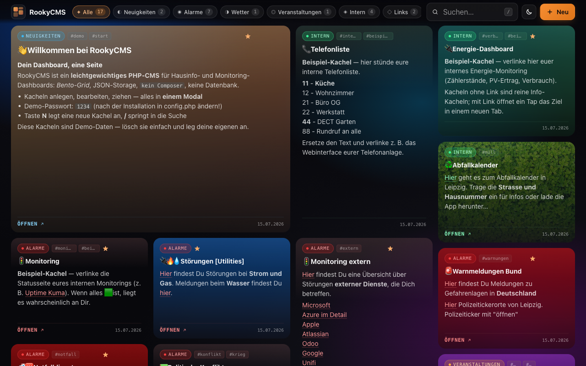
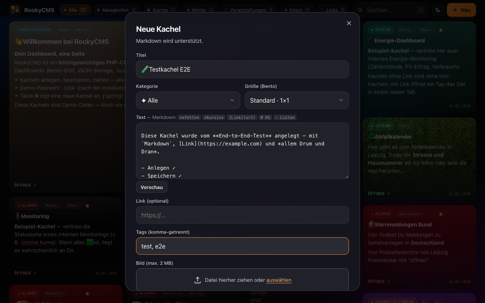

# RookyCMS

**Das Ein-Seiten-Dashboard fürs Zuhause und kleine Teams.**
Monitoring-, Info- und Link-Kacheln in einem Bento-Grid mit Glas-Optik — betrieben mit nichts als PHP und einer JSON-Datei. Keine Datenbank, kein Composer, kein Build-Schritt, keine externen Requests.



## Warum RookyCMS?

Gebaut für den Dauerbetrieb auf einem **Wand- oder Küchen-Tablet im Intranet** (z. B. auf einem NAS): Eine Übersichtsseite zeigt alles, was der Haushalt oder das Team braucht — Monitoring-Status, Warnmeldungen, Wetter, interne Tools, Links. Bearbeitet wird direkt auf der Seite über ein einziges Modal.

- **Eine Seite, ein Modal.** Anlegen, Bearbeiten, Löschen, Umsortieren — ohne Seiten-Reload, ohne Adminbereich.
- **JSON statt Datenbank.** Der komplette Bestand lebt in `data/entries.json` — mit exklusivem Lock, atomarem Schreiben und automatischer Backup-Rotation trotzdem robust.
- **Ruhig im Betrieb.** Statischer Aurora-Hintergrund, kein `backdrop-filter`, keine Endlos-Animationen — keine GPU-Dauerlast auf Tablets. Leises Polling aktualisiert nur bei echten Änderungen.
- **Tablet-taugliche Sicherheit.** Kein dauerhaftes Eingeloggt-Sein: Jede Schreibaktion fragt das Passwort frisch ab, es wird nie gespeichert. Das Wand-Tablet darf öffentlich hängen.
- **Läuft überall, wo PHP läuft.** PHP 8.3+, Systemschriften, keine CDNs — auch im Intranet ohne Internetzugang.

## Schnellstart

```bash
git clone https://github.com/Bingerminger/RookyCMS.git
cd RookyCMS/public
php -S localhost:8000
```

Browser: `http://localhost:8000` — fertig.

Beim ersten Aufruf passiert automatisch:

1. `config.php` wird aus `config.example.php` erzeugt (**Demo-Passwort: `1234`**).
2. Der **Demo-Datenbestand** aus `demo-data/` wird als Startinhalt übernommen (17 Beispiel-Kacheln inkl. Bildern).

Danach: **Passwort in `public/config.php` ändern**, Demo-Kacheln nach Belieben löschen und eigene anlegen. Wer leer starten will, löscht einfach alle Demo-Kacheln — der Seed läuft nur, wenn noch gar keine Datendatei existiert.

## Bedienung

| Aktion | So geht's |
|--------|-----------|
| Neue Kachel | Button **„Neu"** oder Taste `N` |
| Bearbeiten / Löschen | Icons auf der Kachel (bei Hover, auf Touch immer sichtbar) |
| Verschieben | Kachel per Drag & Drop ziehen; Drop im Freiraum hängt ans Ende |
| Suchen | `/` fokussiert die Suche (matcht Titel, Text, Tags) |
| Filtern | Kategorie-Chips in der Topbar, Zähler laufen live mit |
| Theme | Sonne/Mond-Button wechselt zwischen Dark und Light |
| Modal schließen | `ESC` |

Jede Schreibaktion fragt das Passwort ab; nach dem Speichern (oder Abbrechen) ist man automatisch wieder abgemeldet.



### Kachelgrößen (Bento)

| Größe | Belegung |
|-------|----------|
| Standard | 1×1 |
| Breit | 2×1 |
| Hoch | 1×2 |
| Groß | 2×2 |

Das Grid ist ein **Masonry-Layout**: Jede Kachel zeigt immer ihren kompletten Inhalt (nichts wird abgeschnitten), die Spaltenzahl wächst mit dem Viewport (1/2/3/4/5/6 Spalten ab 0/640/960/1280/1600/2000 px). Auf dem Smartphone werden alle Kacheln einspaltig.

### Markdown

Im Kacheltext unterstützt (Vorschau im Editor eingebaut):

| Syntax | Ergebnis |
|--------|----------|
| `# H1` … `###### H6` | Überschriften |
| `**fett**` / `*kursiv*` | **fett** / *kursiv* |
| `` `code` `` / `~~strike~~` | `code` / ~~strike~~ |
| `[Text](URL)` | Link (öffnet in neuem Tab) |
| `- Item` | Listen |
| Leerzeile | Absatz |

Das HTML wird ausschließlich **serverseitig** und XSS-sicher erzeugt — der Client parst kein Markdown.

## Konfiguration

`public/config.php` (entsteht aus `config.example.php`):

| Konstante | Bedeutung |
|-----------|-----------|
| `ADMIN_PASSWORD` | Passwort für alle Schreibaktionen — **unbedingt ändern!** |
| `AUTO_REFRESH_SECONDS` | Polling-Intervall in Sekunden (`0` = aus) |
| `SITE_TITLE` | Titel in Topbar und Browser-Tab |

Akzentfarbe und Raster-Dichte: `public/css/styles.css` (`--accent-h/-s/-l` bzw. Media Queries unter „Bento Grid").

## Installation & Betrieb

Kurzfassung: Webroot auf `public/` zeigen lassen (oder das Projekt in einen Webserver-Ordner legen und `…/public` aufrufen), PHP 8.3+ mit Schreibrecht auf `public/data/` und `public/uploads/` — mehr braucht es nicht. GD ist optional (verkleinert große Upload-Bilder automatisch).

Details für NAS (Synology Web Station), Apache, nginx und Updates: **[docs/INSTALL.md](docs/INSTALL.md)**

## Technik

- **[docs/ARCHITECTURE.md](docs/ARCHITECTURE.md)** — Rendering-Modell, Persistenz-Robustheit (Lock + atomares Schreiben + Backups), Polling, Masonry-Layout, Performance-Prinzipien
- **[docs/API.md](docs/API.md)** — die sechs AJAX-Endpoints mit Beispielen
- **[docs/SECURITY.md](docs/SECURITY.md)** — Auth-Modell, Bedrohungsannahmen, Upload-Härtung
- **[CHANGELOG.md](CHANGELOG.md)** — Versionshistorie

Stack: PHP 8.3+ (Enums, Readonly Properties, typed class constants), Vanilla JS (eine ES6-Klasse), CSS3 mit Custom Properties. Keine Abhängigkeiten.

## Herkunft

RookyCMS ist aus einem privaten Hausinfo-Dashboard („SimpleCMS") hervorgegangen, das seit Jahren auf einem Küchen-iPad im Dauereinsatz ist. Die Demo-Daten zeigen genau diesen Anwendungsfall — ein Haushalt in Leipzig. 😉

## Lizenz

[MIT](LICENSE) © 2026 Bingerminger
